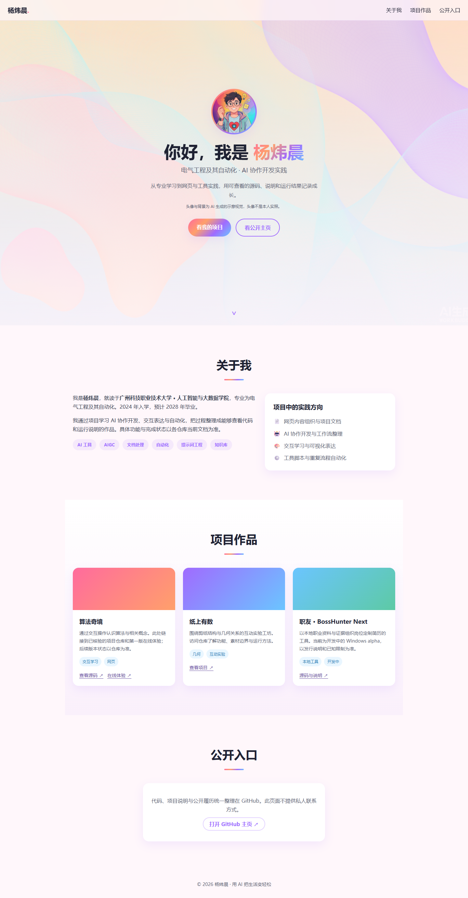

# Personal Portfolio Lite · 个人作品导航

一个无需框架、依赖或本地服务的个人作品单页：基本介绍、实践方向、三个公开项目入口和 GitHub 主页。保留原 WorkBuddy HTML 版本的浅色渐变风格，纠正姓名、无证据项目描述和占位联系链接。

**状态：最小静态单页可运行。** 个人信息仅使用已核验的姓名、学校、专业与就读年份；项目卡是公开仓库导航，不代表这些工具被打包进本站。

[在线预览](https://yangwei251003.github.io/personal-portfolio-lite/) · [素材来源](ASSET_LICENSES.md) · [更新记录](CHANGELOG.md)



## 内容与技术

- HTML + CSS + 原生 JavaScript，无 npm 依赖、模型 API、后端、表单、定位或统计追踪。
- 响应式导航、滚动渐显、键盘菜单关闭与减少动态效果支持。
- 导航至算法奇境、纸上有数、职友 / BossHunter Next；每个项目的当前功能和状态以其仓库为准。
- 不展示私人电话、邮箱、微信、QQ、住址、账户或原始履历证明。
- 两张原图片具有 WorkBuddy AI 生成水印和元数据，原字节完整保留；头像明确是示意图，非本人实照。

## 打开与修改

直接双击 `index.html` 即可使用，无需启动本地服务。也可以在项目目录运行：

```sh
python -m http.server 8000
```

然后打开 `http://localhost:8000`。

文字和项目链接位于 `index.html`；颜色与布局在 `style.css`；导航和渐显在 `script.js`。新增履历须先核验，新增媒体须记录来源。不要把私人联系方式、证件或账户数据填入准备公开的版本。

## 目录

```text
index.html / style.css / script.js  完整单页源码
assets/avatar.png / hero.png       原 AI 生成图片，含生成标识
docs/images/desktop.png            本次真实运行截图
scripts/build_pages.py             只打包明确公开的运行文件
.github/workflows/pages.yml        GitHub Pages 部署
```

## 运行检查

本次在 Chrome 验证文件直接打开及仓库子路径 HTTP 访问；桌面和手机菜单、页面导航、图片、无横向溢出与减少动态效果均按实际检查记录交付。源码与图片元数据另做两轮敏感信息核查；详见 `verification.json`。

没有 CMS、联系表单后端或其他独立页面。README 与网页不夸大所链接项目的开发状态，也不把示例头像当作真人照片。MIT 覆盖自有源码与新增文档；原 AI 视觉及平台标识的使用边界见 `ASSET_LICENSES.md`。远端发布和可删除清单由最终仓库校验后确认。

## 同项目的早期内联版本

[早期版本源码与验证](variants/early-inline/README.md) · [独立预览](https://yangwei251003.github.io/personal-portfolio-lite/variants/early-inline/)

保全2026年8月26日独立主题单页及两份性能观测程序；原四份文件经姓名、履历示例和私密路径修正。此版本与当前主页并存，不代表已证实Git祖先关系。性能程序输出是实际本机观测，最大事件时长不等于标准INP，偏移量简单相加不等于标准CLS。
