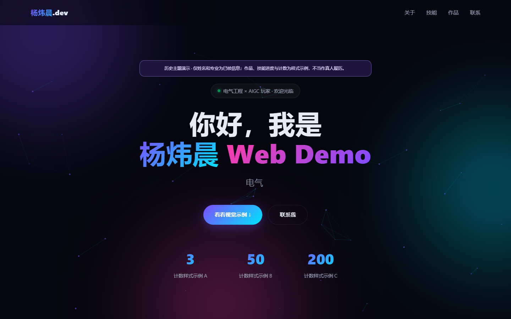

# 早期内联主页主题

> Personal Portfolio Lite 家族的历史视觉变体。姓名与专业采用核实信息；技能进度、计数、作品卡和艺术文案均为明确标注的界面示例，不能当作作者的已完成项目或真实业绩。



这个版本用一个 HTML 文件实现紫青渐变、SVG/CSS 视觉卡片、Canvas 粒子、打字效果、滚动渐入和手机导航。页面不依赖框架、远程字体、图库或模型服务，适合学习原生前端效果，也保留了两个自行编写的 PerformanceObserver 实验脚本。

[维护中的主页](https://yangwei251003.github.io/personal-portfolio-lite/) · [主页仓库](https://github.com/yangwei251003/personal-portfolio-lite)

本目录建议归档于同仓库 `variants/early-inline/`。此早期实现与维护版的 CSS、脚本和布局不同；来源没有可证明提交先后关系的 Git 记录，所以只称“历史主题变体”，不冒称已恢复原提交历史。在线入口需由维护仓库的发布流程显式纳入；当前链接指向维护版。

## 快速打开

直接用浏览器打开 `index.html` 即可体验全部页面功能，无需安装依赖。打开 `cwv-report.html` 查看旧报告校注。

如需本地 HTTP 预览，安装 Node.js 24 或更新版本，在本目录运行：

```sh
node serve.mjs
```

打开终端显示的 `http://127.0.0.1:8770/`。服务只监听本机，只提供两个 HTML 和许可证。修改端口可设置 `PORT`；子路径预览可设置 `BASE_PATH=/variants/early-inline`。页面所有内部跳转使用片段或相对路径，适合 GitHub Pages 子目录；它没有后端。

## 本机观察器实验

测量工具需要 Node.js 24 和已经安装的 Google Chrome。页面本身不需要这些依赖。

```sh
npm ci
npm run dev
# 保持服务运行，在本目录另开终端
npm run measure
npm run recheck
```

`TARGET_URL` 可指定自己的本地测试地址，默认上述地址。`RUNS` 默认 3，允许 1–30；`BROWSER_CHANNEL` 默认 `chrome`，可改为本机已有的 Playwright 支持通道。`OUTPUT_DIR` 默认相对目录 `artifacts`，不包含开发者个人路径。不会自动下载 Chrome，也不会调用模型或真实用户数据。

| 输出 | 含义与边界 |
| --- | --- |
| `lcpCandidateMs` | 从 `LargestContentfulPaint.startTime` 取到的候选时间，修正了旧版重复加上 `renderTime` 的问题；有限本机导航不能代表现场用户表现。 |
| `nonInputShiftSum` | 排除近期输入的布局偏移累计，没有计算现代 CLS 的最大会话窗口。 |
| `maxObservedEventDurationMs` | 超过观察阈值的 Event Timing 事件耗时最大值；缺少标准交互分组和完整生命周期，**不是 INP**。无记录为 `null`。 |
| 正常模式汇总 | 三次相同条件导航的中位数和范围；不是 CrUX/RUM 的现场访问 p75。 |
| 人工节流模式 | 单次 CPU 4×、100 ms 延迟、下载 750 kbps / 上传 375 kbps 的浏览器模拟；不等同物理弱设备。 |

原报告中的数值仍作为**未核验的历史文字**保留在校注页中，不提供通过/失败徽章或优化收益证明。定义参见 [LCP 属性](https://developer.mozilla.org/en-US/docs/Web/API/LargestContentfulPaint)、[CLS 会话窗口](https://web.dev/articles/cls)和 [INP 口径](https://web.dev/articles/inp)。当前验证范围见 [VALIDATION.md](docs/VALIDATION.md)。

## 目录与状态

```text
index.html           单页主题，CSS/脚本/示意图内联
cwv-measure.mjs      多次本机导航与观察器原始记录
cwv-recheck.mjs      实际截图与人工节流实验
cwv-report.html      历史数字及方法问题校注
serve.mjs            仅本机的零依赖预览服务
docs/                本次真实截图与验证说明
licenses/            测量工具原许可证/版权与第三方通知
```

这是可运行的历史演示快照，不视为持续维护的正式数字简历。后续可接入标准 `web-vitals` 采集器并重新设计实验；本次没有实现或验证现场 RUM。已修正手机菜单关闭状态、减少动画时仍运行 JS 动画、计数器未被观察的问题；没有补造旧成绩。

## 许可与公开范围

自有页面、脚本及本次维护内容采用 [MIT](LICENSE)。没有捆绑第三方模板、照片、字体或付费素材；绘制内容来自此源文件的 CSS/SVG/Canvas。测量依赖 Playwright 及 Playwright Core 按 Apache-2.0 和其原第三方条款提供，不属于本项目 MIT 授权，见 [THIRD_PARTY.md](THIRD_PARTY.md)。`node_modules`、浏览器、缓存与实验临时输出不入库。

已移除旧联系方式和本机路径，纠正错误姓名；不包含私人输入、源目录、原始证明材料、凭据或位置数据。本次只归档这四个项目文件及必要维护内容，不能据此删除其所在的整个 WorkBuddy 目录。
