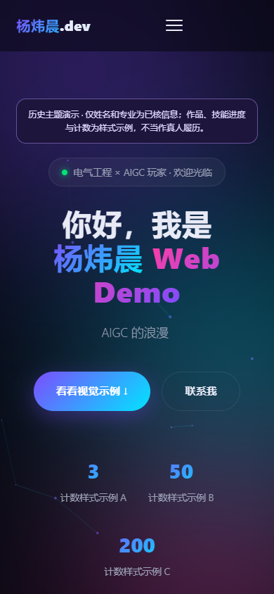

# 验证记录

日期：2026-10-27。本次在 Windows、Node.js 24.15.0、Google Chrome 156.0.8078.47、Playwright 1.64.1 的独立无头浏览器中完成；未操作用户浏览器或远端服务。

| 检查 | 结果 |
| --- | --- |
| `npm ci` | 按锁文件重新安装成功，只有 Playwright 与 Playwright Core 两个可选开发依赖。 |
| `npm audit` | 查询时报告 0 项已知漏洞；不代表绝对安全或未来无新漏洞。 |
| JavaScript 解析 | 3 个 `.mjs` 与 HTML 内联脚本，共 4 段，解析无错误。 |
| HTTP 子路径 | `/variants/early-inline/`，1440×900 和 390×844：页面、滚动内容、六张示例作品卡、手机菜单展开/关闭通过；未发现脚本错误、外部请求、HTTP 失败、横向溢出。 |
| 减少动画 | 390×844：主内容可见，打字与 Canvas 循环停用，菜单可用。 |
| 无服务打开 | 浏览器直接打开 `index.html`：标题/主体可见，无横向溢出。 |
| 本地数据 | 默认页面不写 localStorage，不采集位置或联系信息；没有模型调用。 |
| 截图 | 本目录四张 PNG 均来自公开副本实际运行，没有嵌入 EXIF 或其他文本元数据。 |

## 观察器实验的实际执行

`cwv-measure.mjs` 在上述子路径进行了三次无节流的独立页面导航与一次合成导航点击。LCP 候选时间中位数 292 ms、范围 276–544 ms；非输入布局偏移累计三次约 0.0000036；观察到的事件耗时最大值中位数 56 ms、范围 56–80 ms。这些是当时本机实验的描述，不是现场用户表现，也不声称达到标准 CWV 阈值。

`cwv-recheck.mjs` 完成两张截图，并进行了单次人工 CPU 4×、100 ms 延迟、下载 750 kbps / 上传 375 kbps 的导航。候选时间 680 ms、偏移累计 0.0139、事件耗时最大值 64 ms。人为节流不等同物理设备，单次结果不能支持优化效果比较。

没有标准 INP/会话窗口 CLS 验证、现场 RUM、CrUX、真实业务性能或 GitHub Actions 实机验收。旧报告日期和旧数值缺原日志，不能由此次新运行倒推为真实。本候选也不提供全站性能通过认证。

## 归档边界

公开副本覆盖四个指定文件的自有页面/实验逻辑。旧报告保留数字并改写误导性的结论；源原件不动。联系方式、本机导入和截图路径未公开；原有错名、未核实技能/作品等不作为真人事实。依赖目录、浏览器、实验临时产物、审计日志均不入库。

尚未远端发布本变体，当前维护主页由同仓库主页面提供。最终发布与在线链接核验由仓库维护流程完成。四个文件的安全快照不能证明整个原目录已归档，因此不建议删除其所在 WorkBuddy 目录。
